<div align="center">
  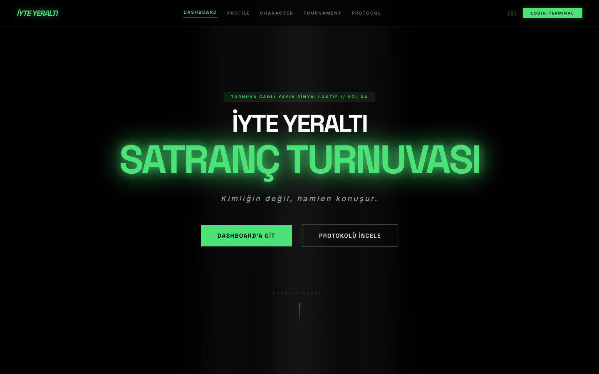

  # ⚡️ İYTE Yeraltı Satranç Turnuvası (V2) ⚡️

  *Gelecek hamleni yap, sistemi hackle! ♟️💾*

  **İYTE (İzmir Yüksek Teknoloji Enstitüsü)** IEEE Öğrenci Kolu için özel olarak tasarlanmış, **Cyberpunk/Underground** temalı, tamamen otonom ve yapay zeka destekli bir satranç turnuvası yönetim platformudur.
</div>

---

## 🚀 Proje Hakkında

Geleneksel satranç atmosferini modern, karanlık ve fütüristik bir "Underground" estetiğiyle birleştiriyoruz. Kullanıcıların gerçek isimlerini geride bırakıp kendi **"Kod Adları"** ve **"Oyun Karakteristikleri" (Archetype)** ile katıldıkları, Lichess entegrasyonu sayesinde tamamen otomatik ilerleyen bir turnuva ekosistemi.

### 🌟 Öne Çıkan Özellikler

- **🎭 Karakter ve Kod Adı Sistemi:** Her oyuncu kayıt olurken "Hacker, Nomad, Corporate" gibi cyberpunk temasına uygun bir Codename seçer ve bir oyun arketiği (Taktiksel, Merkezi Kontrol, Piyon Yapısı vb.) belirler.
- **🤖 Yapay Zeka Destekli Doğrulama (Neural Gateway):** Google Gemini AI kullanılarak, seçilen kod adlarının temaya uygunluğu gerçek zamanlı denetlenir. Gerçek isimler, konumlar veya argo kelimeler anında sistem tarafından reddedilir.
- **⚔️ Lichess Hayalet Maç Entegrasyonu:** Turnuva eşleşmeleri yapıldığında, sistem Lichess API'si üzerinden otonom olarak (Ghost Match) maç linkleri üretir. Oyuncular profillerindeki butona tıklayarak doğrudan kendi maçlarına intikal ederler. Sonuçlar (Kazanan/Kaybeden/Berabere) Lichess'ten anlık çekilip sisteme yansıtılır.
- **📡 Gerçek Zamanlı Dashboard:** Firebase Firestore ile turnuva durumunu, oyuncu kayıtlarını, maç ağacını ve operatör listesini milisaniye gecikmeyle canlı olarak takip edin.
- **🕰️ Akıllı Bildirim Sistemi:** Eşleşmesi belli olan oyuncuların profil sayfasına, maça tam 48 saat kala "SİSTEM MESAJI" olarak yaklaşan müsabaka detayları (rakip bilgileri, saat, tarih) düşer.
- **🛡️ Admin Kontrol Paneli:** Güvenli `.env` yetkilendirmesi sayesinde sadece sistem yöneticileri yeni turlar oluşturabilir, eşleşmeleri başlatabilir ve turnuva ağacını yönetebilir.
- **✨ Premium Cyberpunk Arayüz:** Neon ışıklar, glitch efektleri, scanline animasyonları, koyu mod tasarımı ve Framer Motion ile güçlendirilmiş akıcı mikro animasyonlar.

---

## 📸 Ekranlar

<p align="center">
  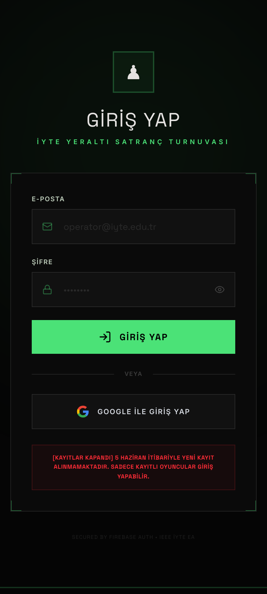
  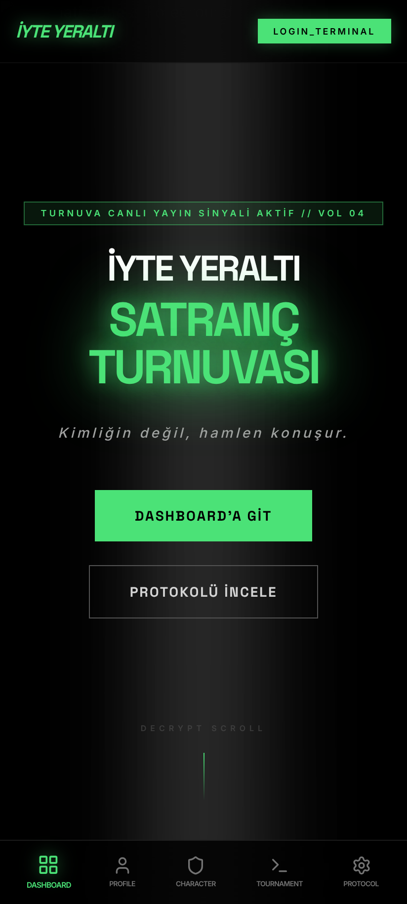
  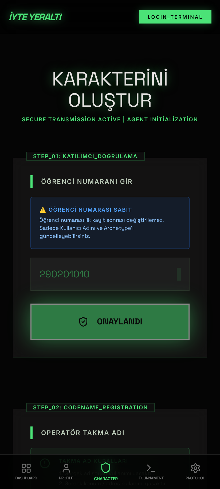
  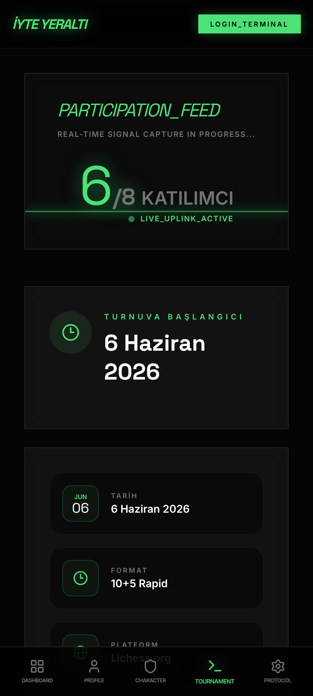
  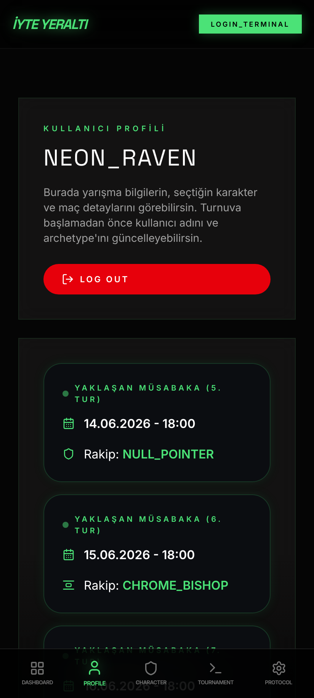
  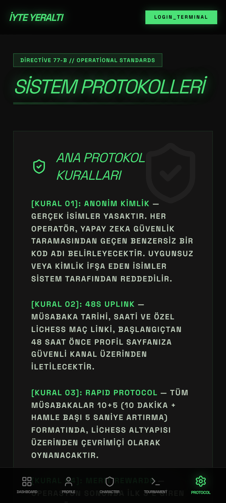
</p>

| Ekran | Ne yapar? |
|---|---|
| 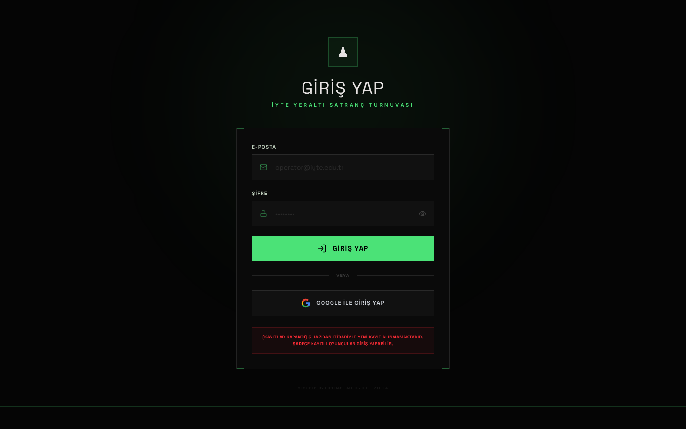<br/>**Giriş** | E-posta/şifre veya Google ile Firebase Authentication girişi. Kayıt süresi dolduysa (6 Haziran 2026 23:59, TSİ) veya turnuva başladıysa yeni kayıt alınmadığı uyarısı gösterilir. |
| 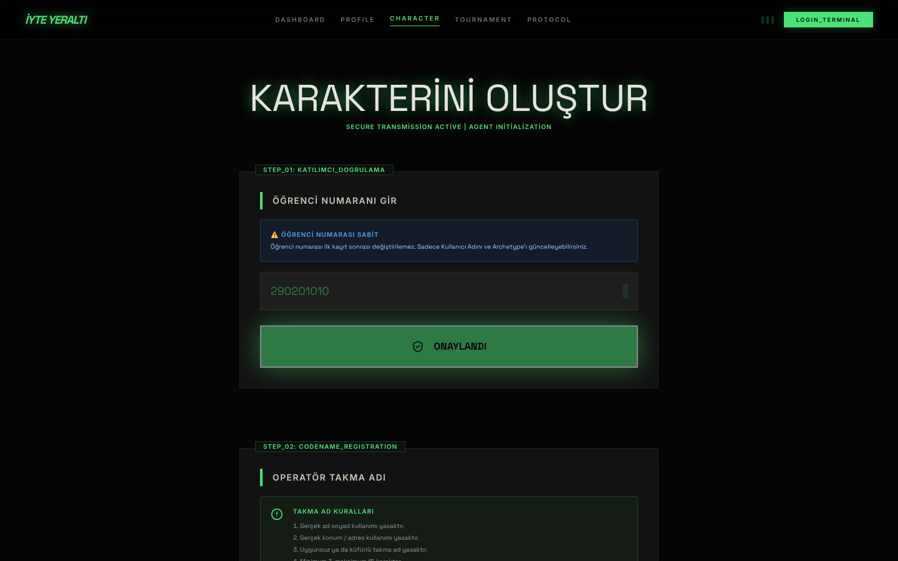<br/>**Karakter oluşturma** | 9 haneli öğrenci numarası (bir kez girilir, değiştirilemez), yapay zekâ ile denetlenen **kod adı** ve oyun **arketipi** seçilir. Aynı öğrenci numarası veya kod adı ikinci kez kullanılamaz. |
| 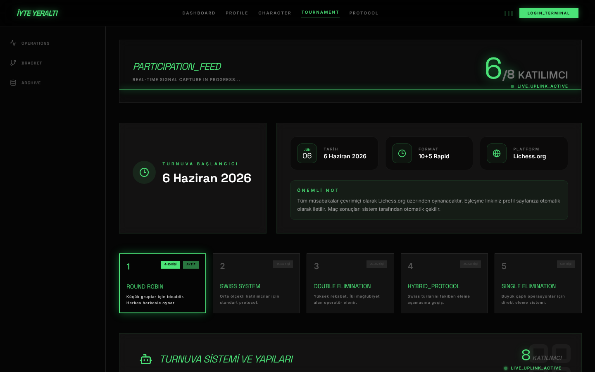<br/>**Turnuva paneli** | Katılımcı sayısı, başlangıç tarihi, format (10+5 Rapid, Lichess) ve oyuncu sayısına göre otomatik seçilen turnuva sistemi. |
| 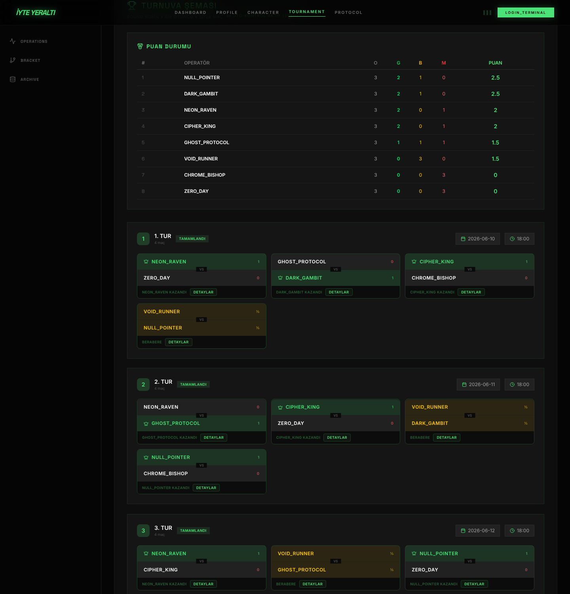<br/>**Puan durumu ve tur eşleşmeleri** | Canlı puan tablosu (G=1, B=½, M=0) ve her turun eşleşmeleri. Admin turu başlatınca her maç için Lichess linki üretilir; sonuçlar 30 saniyede bir otomatik çekilir. |
| 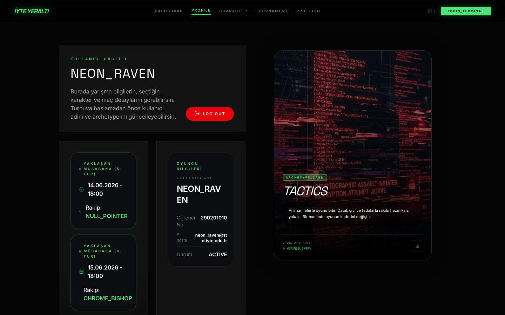<br/>**Profil** | Oyuncunun kod adı, arketipi, öğrenci bilgileri ve yaklaşan müsabakaları (tarih, saat, rakip). Tur başladığında kişiye özel Lichess linki sayfanın üstündeki maç banner'ında belirir. |
| 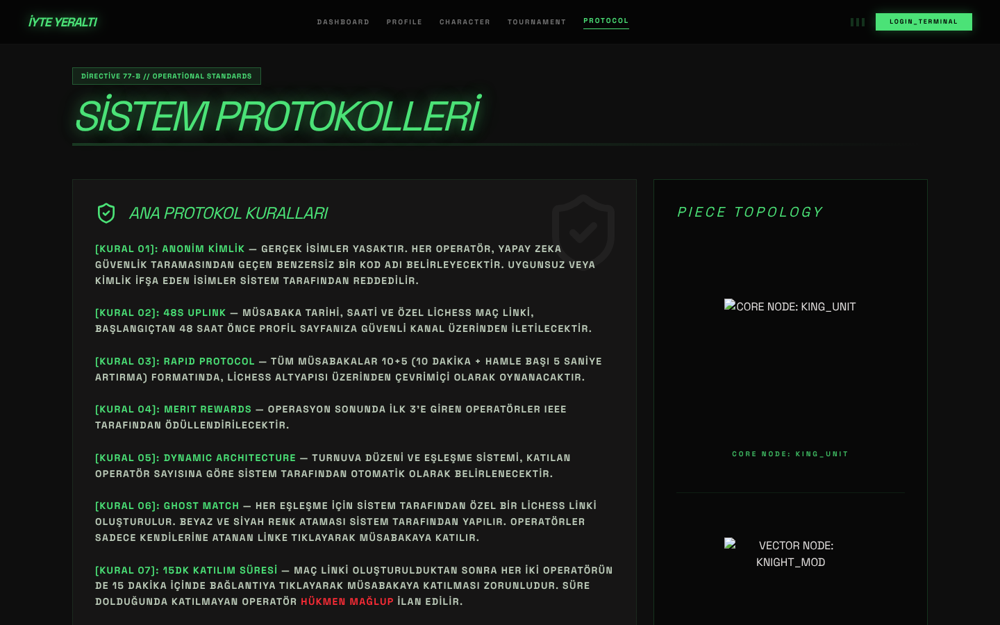<br/>**Sistem protokolleri** | Turnuva kuralları: anonim kimlik, 10+5 süre, 15 dk katılım süresi (gelmeyen hükmen mağlup), adil oyun ve disiplin kuralları. |

> Görseller, Firebase yerine örnek turnuva verisi kullanan **ekran görüntüsü modu** ile uygulamanın gerçek sayfalarından üretilir: `npm run screenshots` → `docs/screenshots/`.

---

## ⚙️ Nasıl Çalışır?

### Genel mimari

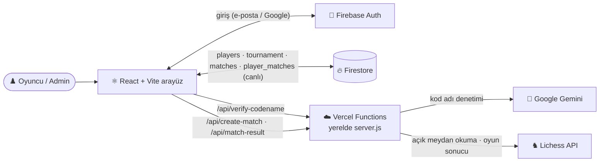

API anahtarları (Gemini) yalnızca sunucu tarafında (`api/` ve `server.js`) kullanılır; tarayıcıya gönderilmez.

### Kayıt akışı

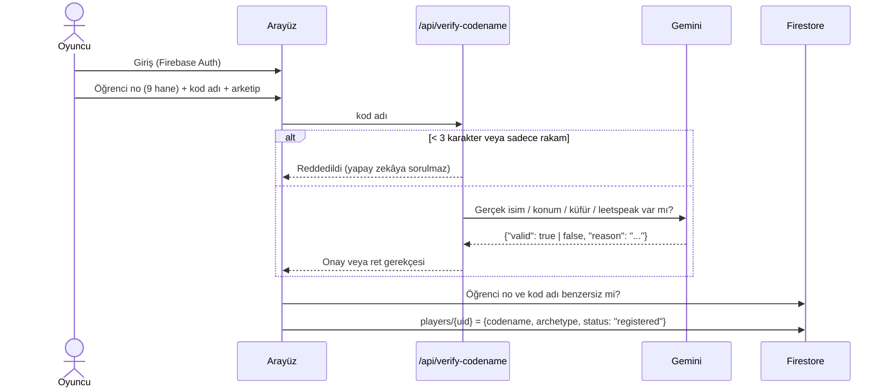

### Turnuva formatı (oyuncu sayısına göre otomatik)

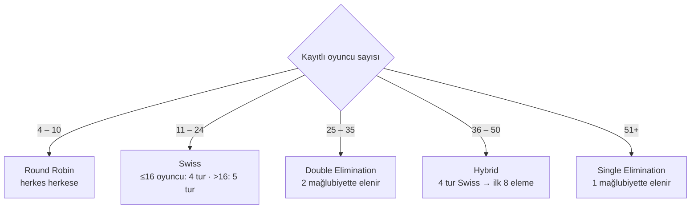

- **Puanlama:** galibiyet 1, beraberlik ½, mağlubiyet 0; bay (BYE) 1 puan. Sıralama puana, eşitlikte galibiyet sayısına göre.
- **Swiss:** her tur puan sırasına göre, daha önce karşılaşmamış en yakın rakiple eşleşilir; tek sayıda oyuncuda bay, daha önce bay almamış en alttaki oyuncuya verilir.
- **Double Elimination:** kazananlar ve kaybedenler grubu ayrı eşleşir; büyük finali kaybedenler grubundan gelen kazanırsa rövanş (reset) oynanır. 4. turdan sonra (admin panelindeki seçenek kapatılmazsa) iki grup tek havuzda birleştirilir ve kalan oyuncular rastgele eşleşir.
- **Hybrid:** 4 Swiss turundan sonra ilk 8, çeyrek finalde 1–8, 4–5, 2–7, 3–6 eşleşir; ardından yarı final ve final (toplam 7 tur).

### Bir maçın yaşam döngüsü

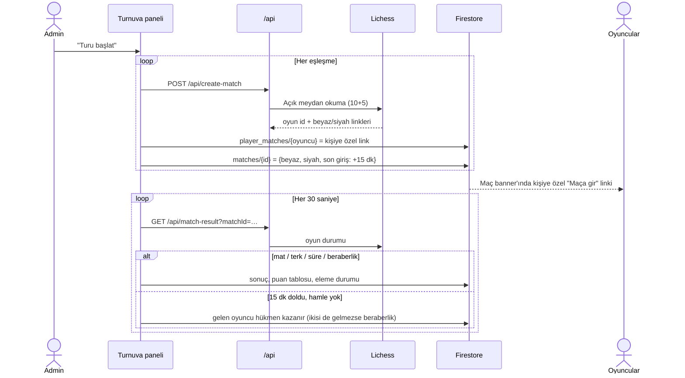

### Firestore veri yapısı

```
players/{uid}             codename (BÜYÜK HARF), studentId, archetype, email, status (registered|active|eliminated), wins, losses, draws
tournament/current        format, status (active|completed), playerIds[], rounds[{roundNumber, date, time, started, matches[]}], mergeRound?
matches/{lichessId}       whitePlayerId, blackPlayerId, status, deadline, tournamentRound, winner, result
player_matches/{uid}      upcomingMatch (kişiye özel Lichess linki), matchId, matchColor
```

---

## 🛠️ Teknoloji Yığını (Tech Stack)

### Frontend
- **Framework:** React 19 (Vite) + TypeScript
- **Styling:** Tailwind CSS 4, Vanilla CSS (Custom Glitch & CRT Effects)
- **Animasyon:** Framer Motion
- **İkonlar:** Lucide React

### Backend & API
- **Sunucu / Serverless:** Node.js, Express (Lokal), Vercel Functions (Canlı)
- **Veritabanı & Kimlik Doğrulama:** Firebase (Firestore, Auth)
- **Yapay Zeka:** `@google/genai` (Gemini 3.1 Flash Lite - Hızlı ve hataya dirençli NLP motoru)
- **Satranç Motoru Entegrasyonu:** Lichess API (Challenge/Export endpoints)

---

## 📦 Kurulum ve Çalıştırma (Geliştiriciler İçin)

### Gereksinimler
- Node.js (v18 veya üzeri)
- npm veya yarn
- Firebase Projesi (Firestore ve Auth aktifleştirilmiş)
- Google Gemini API Anahtarı

### Adımlar

1. **Depoyu Klonlayın:**
   ```bash
   git clone https://github.com/alikemaltopak/IYTE-Underground-Chess-IEEE.git
   cd IYTE-Underground-Chess-IEEE
   ```

2. **Bağımlılıkları Yükleyin:**
   ```bash
   npm install
   ```

3. **Çevresel Değişkenleri Ayarlayın:**
   `.env.example` dosyasını `.env` olarak kopyalayıp değerleri kendi projenize göre doldurun. `.env*` dosyaları `.gitignore`'dadır, git'e gönderilmez:
   ```env
   # Firebase Configuration
   VITE_FIREBASE_API_KEY=your_api_key
   VITE_FIREBASE_AUTH_DOMAIN=your_project.firebaseapp.com
   VITE_FIREBASE_PROJECT_ID=your_project_id
   VITE_FIREBASE_STORAGE_BUCKET=your_project.appspot.com
   VITE_FIREBASE_MESSAGING_SENDER_ID=your_sender_id
   VITE_FIREBASE_APP_ID=your_app_id
   VITE_FIREBASE_MEASUREMENT_ID=your_measurement_id

   # Gemini AI Configuration
   VITE_GEMINI_API_KEY=your_gemini_api_key
   GEMINI_API_KEY=your_gemini_api_key

   # Admin Authorization (Araya virgül koyarak birden fazla admin ekleyebilirsiniz)
   VITE_ADMIN_EMAILS=admin1@gmail.com,admin2@gmail.com

   # Local Server Port (Opsiyonel)
   PORT=3001
   ```

4. **Geliştirme Sunucusunu Başlatın:**
   ```bash
   npm run dev
   ```
   **Not:** Localde çalışırken AI doğrulama ve Lichess testleri arka planda Proxy aracılığıyla `server.js` (`localhost:3001`) üzerinden çalışacaktır.

---

## 🧪 Testler ve Doğrulama Sonuçları

Uygulamanın vaat ettiği davranışları doğrulayan otomatik testler [Vitest](https://vitest.dev) ile yazılmıştır. Firebase, Lichess ve Gemini taklit edilir; gerçek hesap veya API anahtarı gerekmez.

```bash
npm test
```

Turnuva mantığı (format seçimi, eşleştirme, puan tablosu, eleme, Lichess sonucu ve hükmen kararı) test edilebilmesi için `src/tournament/engine.ts` dosyasına taşınmıştır; `TournamentBracket` bileşeni bu modülü kullanır.

### Son çalıştırma sonucu

> 22 Ekim 2026 · Node.js 22 · Vitest 3.2 — **5 dosya, 97 test, 97 başarılı ✅, 0 başarısız** (+ emülatörde 16 kural testi)

| Test dosyası | Test | Sonuç | Doğrulanan davranış |
|---|:-:|:-:|---|
| `tests/engine.test.ts` | 62 | ✅ | Oyuncu sayısına göre format; Round Robin'de her ikilinin tam bir kez karşılaşması; puanlama (1 / ½ / 0, bay = 1) ve sıralama; Swiss tur sayısı, tekrar eşleşme olmaması, aynı oyuncuya ikinci bay verilmemesi; tek/çift eleme turnuvalarının tek şampiyonla bitmesi, büyük final ve rövanş, birleşme turu; Hybrid çeyrek final tohumlaması (1–8, 4–5, 2–7, 3–6) ve 7 turda bitiş; eleme kuralları; Lichess sonuç eşlemesi; hükmen mağlubiyet kararı |
| `tests/api.test.ts` | 21 | ✅ | `/api/create-match` 10+5 Lichess maçı ve beyaz/siyah linkleri, hata durumları; `/api/match-result` sonuç, beraberlik, henüz başlamamış maç (404 → `created`); `/api/verify-codename` Gemini onayı/reddi, JSON ayıklama, hata durumunda güvenli ret, yerel ön kontroller, eksik API anahtarı; jetonsuz/yetkisiz isteklerin reddi, CORS, geçersiz maç kimliği, 15 karakter sınırı, hata ayrıntısının sızdırılmaması |
| `tests/playerService.test.ts` | 7 | ✅ | E-posta ve öğrenci no'nun herkese açık kartta tutulmaması, kayıt `registered` durumunda, öğrenci numarası ve kod adı benzersizliği (büyük/küçük harf duyarsız), öğrenci numarasının değiştirilememesi, profil güncelleme |
| `tests/admin.test.ts` | 3 | ✅ | Admin sayılmak için e-postanın listede ve doğrulanmış olması |
| `tests/date.test.ts` | 5 | ✅ | Kayıt kapanışı (6 Haziran 2026 23:59:59 TSİ, saat diliminden bağımsız; turnuva başlayınca kapalı), maç son giriş zamanının her formatta güvenle okunması |

### Testlerle bulunan ve düzeltilen hatalar

| # | Bulgu | Durum |
|---|---|---|
| 1 | **Swiss'te aynı oyuncu iki kez bay alıyordu** (ör. 13 ve 23 oyunculu turnuvada). Bay geçmişi "hiç maçta olmayan oyuncu" diye aranıyordu, ama bay `BYE` rakipli bir maç olarak kaydediliyor. | ✅ Düzeltildi |
| 2 | **Swiss'te kaçınılabilir tekrar eşleşme** (ör. 20 oyuncuda son tur iki oyuncuyu ikinci kez karşılaştırıyordu). Açgözlü eşleştirmeye, tekrarsız eşleştirmeyi arayan geri izlemeli bir adım eklendi; mümkün değilse eski davranış sürer. | ✅ Düzeltildi |
| 3 | **Aynı kod adı ikinci kez alınabiliyordu:** benzersizlik kontrolü büyük harfli adı arıyor, kayıt ise yazıldığı gibi saklanıyordu. Kod adları artık büyük harfle kaydediliyor; kontrol eski kayıtları da buluyor. | ✅ Düzeltildi |
| 4 | Canlıdaki (Vercel) kod adı doğrulamasında, yerel sunucudaki "en az 3 karakter / sadece rakam olamaz" ön kontrolleri yoktu. | ✅ Düzeltildi |
| 5 | **Hybrid ve tek elemede beraberlik:** eleme turunda berabere biten maçta iki oyuncu da elenmiyor. Hybrid'de bu durumda bir sonraki turda rakibi boş (`null`) bir maç oluşuyor. Beraberlikte ne olacağına (rövanş, Armageddon vb.) karar verilmesi gerekiyor. | ⚠️ Açık — kural kararı gerekiyor |
| 6 | `TournamentBracket.tsx` içinde, admin paneli her açıldığında 5. turdaki belirli bir oyuncu kimliğini başka bir kimlikle değiştiren tek seferlik bir düzeltme kodu duruyor. Yeni bir turnuvada bu kimlikler 5. turda yer alırsa eşleşmeyi sessizce değiştirir. | ⚠️ Açık — işi bittiyse kaldırılmalı |
| 7 | Güvenlik kuralları repoda yoktu; e-posta ve öğrenci numaraları herkese açıktı, oyuncular kendi skorlarını ve maç kayıtlarını değiştirebiliyordu. | ✅ Düzeltildi — bkz. [Güvenlik ve Kişisel Veriler](#-güvenlik-ve-kişisel-veriler) |
| 8 | Arayüz kod adı için "en fazla 15 karakter" diyor, yapay zekâ istemi 20 diyordu; üst sınır kodla uygulanmıyordu. | ✅ Düzeltildi — sunucuda ve kurallarda 15 |

### Test kapsamı dışında kalanlar

Gerçek Firebase girişi, Firestore güvenlik kuralları, canlı Lichess/Gemini yanıtları ve 30 saniyelik otomatik sonuç kontrolünün tarayıcıda çalışması taklitlerle değil, gerçek ortamda manuel olarak doğrulanmalıdır.

---

## 🔐 Güvenlik ve Kişisel Veriler

### Veriler nerede, kim görebilir?

| Koleksiyon | İçerik | Okuma | Yazma |
|---|---|---|---|
| `players/{uid}` | Kod adı, arketip, durum, skor (**e-posta ve öğrenci no yok**) | Herkes | Oyuncu: sadece kendi kod adı/arketipi (kayıt süresi içinde oluşturma) · Admin: hepsi |
| `players_private/{uid}` | E-posta, öğrenci no | Sadece sahibi ve adminler | Oyuncu: sadece kayıtta bir kez · Admin |
| `student_ids/{no}` | Öğrenci no → uid (benzersizlik) | Tek numara sorgusu (giriş yapmış kullanıcı), liste: admin | Kayıtta bir kez · Admin |
| `tournament/current` | Turnuva şeması | Herkes | Sadece admin |
| `matches/{id}` | Maç durumu, oyuncu kimlikleri | Herkes | Oyuncu: sadece kendi renginin "maça girdi" işareti · Admin: hepsi |
| `player_matches/{uid}` | Kişiye özel Lichess linki | Sadece sahibi ve admin | Sadece admin |

- **Admin** = e-postası listede **ve doğrulanmış** kullanıcı. Admin e-postasıyla şifreli hesap açan biri admin olamaz. Liste üç yerde aynı tutulmalı: `firestore.rules`, `VITE_ADMIN_EMAILS` (arayüz), `ADMIN_EMAILS` (sunucu; boşsa `VITE_ADMIN_EMAILS`).
- **Sunucu fonksiyonları:** `/api/verify-codename` sadece oturum açmış kullanıcılara, `/api/create-match` sadece adminlere açıktır (Firebase kimlik jetonu doğrulanır). `/api/match-result` sadece geçerli Lichess oyun kimliği kabul eder. CORS varsayılan olarak kapalıdır, gerekirse `ALLOWED_ORIGINS` ile açılır.
- **Kod adı:** 3–15 karakter sunucuda uygulanır; kod adı yapay zekâya "veri" olarak verilir, içindeki talimatlar dikkate alınmaz.
- **Maç sonuçları ve hükmen kararlar** sadece admin tarayıcısından yazılır: admin turnuva sayfasını açık tuttuğunda 30 saniyede bir Lichess kontrol edilir.

### Kuralları yayınlama (sıra önemli)

1. Bu sürümü yayınlayın (Vercel). Vercel ortam değişkenlerinde `VITE_FIREBASE_PROJECT_ID` ve `VITE_ADMIN_EMAILS` bulunmalı.
2. Mevcut e-posta ve öğrenci numaralarını gizli koleksiyona taşıyın (önce rapor, sonra uygulama):
   ```bash
   GOOGLE_APPLICATION_CREDENTIALS=servis-hesabi.json FIREBASE_PROJECT_ID=iyte-satranc-ieee node scripts/migrate-private-player-data.mjs
   GOOGLE_APPLICATION_CREDENTIALS=servis-hesabi.json FIREBASE_PROJECT_ID=iyte-satranc-ieee node scripts/migrate-private-player-data.mjs --apply
   ```
3. `firestore.rules` dosyasını yayınlayın: Firebase konsolu → Firestore → Rules (dosyanın içeriğini yapıştırın) veya `firebase deploy --only firestore:rules`.

> Yeni bir turnuva dönemi için kayıt son tarihi iki yerde güncellenmelidir: `src/utils/date.ts` ve `firestore.rules` (`registrationOpen`).
> `scratch/` altındaki oturumsuz istemci betikleri yeni kurallarla çalışmaz; bakım işleri için firebase-admin kullanan betikler tercih edilmelidir.

### Kural testleri

Kurallar Firebase Emulator üzerinde 16 senaryoyla test edilir (Java gerekir):

```bash
npm run test:rules
```

> Son çalıştırma (22 Ekim 2026): **16/16 başarılı ✅**. Aynı testler önceki canlı kurallarla çalıştırıldığında 8'i başarısız oluyordu. Bunlar arasında doğrulanmamış admin e-postasının admin sayılması, oyuncunun kendi skorunu/durumunu değiştirebilmesi, herhangi bir maç belgesinin değiştirilebilmesi ve oyuncunun kendi Lichess linkini yazabilmesi var.

---

## 🚀 Deployment (Vercel)

Proje Vercel üzerinde tek tıkla çalışacak şekilde (`vercel.json` rewrite ayarları dahil) konfigüre edilmiştir. 
Vercel'e yüklerken, `Settings > Environment Variables` kısmından tüm `.env` değişkenlerinizi eklemeyi unutmayın! Node.js Serverless fonksiyonları (`api/verify-codename.js` vb.) otomatik olarak derlenecektir.

---

## 📁 Proje Yapısı

```
├── api/                    # Vercel Serverless Functions (Gemini kod adı denetimi, Lichess maç/sonuç)
├── docs/screenshots/       # README ekran görüntüleri
├── public/                 # Statik Varlıklar (Görseller, Arka Planlar)
├── screenshots/            # Ekran görüntüsü modu (örnek veri + Firebase taklidi, npm run screenshots)
├── src/
│   ├── components/         # Tekrar Kullanılabilir UI (Navbar, TournamentBracket, GlobalMatchBanner)
│   ├── context/            # React Context (AuthContext)
│   ├── pages/              # Ana Sayfalar (Dashboard, Profile, Rules vb.)
│   ├── services/           # Firebase DB Servisleri (playerService, vb.)
│   ├── tournament/         # Turnuva motoru: format, eşleştirme, puan tablosu, eleme kuralları
│   ├── utils/              # Kayıt kapanışı ve tarih yardımcıları
│   ├── App.tsx             # Ana Router / View Controller
│   ├── firebase.ts         # Firebase Başlatma Konfigürasyonu
│   └── index.css           # Global Cyberpunk Tasarım Tokenları
├── tests/                  # Vitest testleri (npm test)
├── rules-tests/            # Firestore kural testleri (npm run test:rules, emülatör)
├── scripts/                # Bakım betikleri (kişisel veri taşıma)
├── firestore.rules         # Firestore güvenlik kuralları
├── server.js               # Lokal Geliştirme İçin Express Backend
├── vercel.json             # Vercel Dağıtım Kuralları
└── vite.config.ts          # Vite ve Proxy Ayarları
```

---

## 🛡️ Lisans ve Haklar

Bu proje, **IEEE İYTE Öğrenci Kolu** kapsamında etkinlik yönetimi için tasarlanmış ve geliştirilmiştir.  
Tüm hakları saklıdır. Sisteme sızmaya çalışmayın. *Gözümüz üzerinizde.* 👁️
